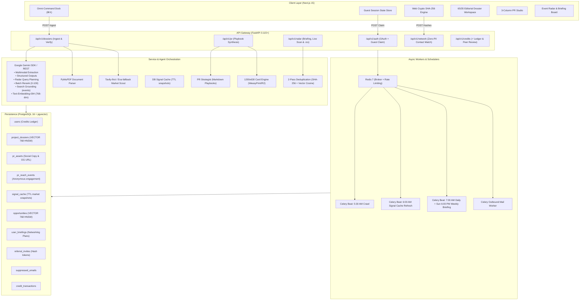
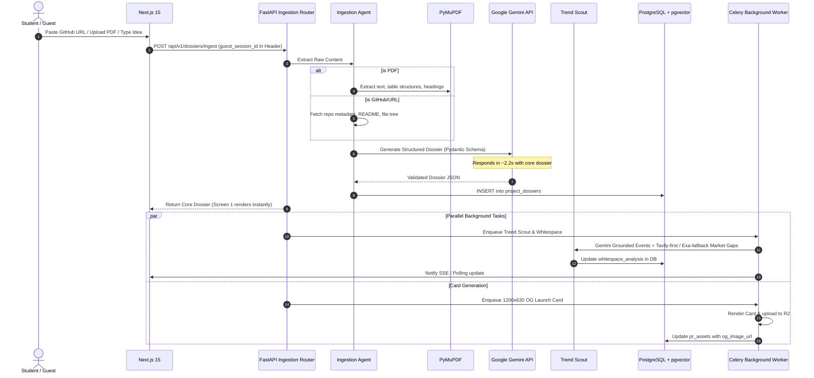
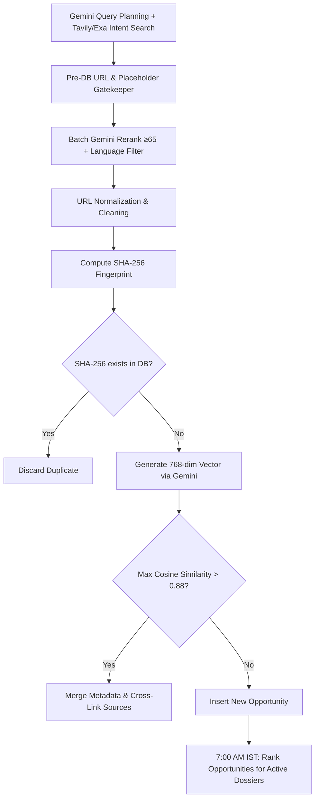
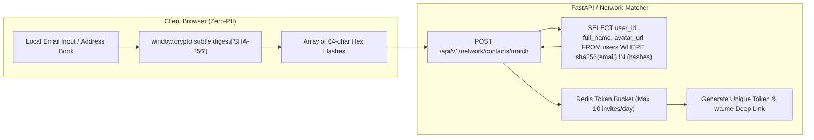

# 🏛️ System Architecture Specification

## 1. High-Level System Overview

The **AI-Powered Student Radar** is architected as a high-performance full-stack system designed to execute asynchronous multi-modal ingestion, deterministic structured LLM extraction, vector semantic search, and privacy-preserving network graph matching.



---

## 2. Database Schema & Data Models (PostgreSQL 16 + pgvector)

All vector columns utilize standard 768 dimensions corresponding to `text-embedding-004` / Gemini embeddings. HNSW indexes are applied for rapid nearest-neighbor lookup (`m=16, ef_construction=64`).

### 2.1 Table Specifications

```sql
-- Extension initialization
CREATE EXTENSION IF NOT EXISTS "uuid-ossp";
-- Only run this when pgvector is not already provided by a staged DLL.
-- Creating the extension over manually installed vector functions can load
-- two copies of the library and raise "attempt to redefine parameter
-- hnsw.ef_search".
-- CREATE EXTENSION IF NOT EXISTS "vector";

-- 1. Users & Profiles
CREATE TABLE users (
    id UUID PRIMARY KEY DEFAULT uuid_generate_v4(),
    email VARCHAR(255) UNIQUE NOT NULL,
    hashed_password VARCHAR(255),
    full_name VARCHAR(120),
    avatar_url TEXT,
    oauth_provider VARCHAR(50) DEFAULT 'google',
    oauth_id VARCHAR(255),
    credits_balance INTEGER DEFAULT 30 CHECK (credits_balance >= 0),
    created_at TIMESTAMP WITH TIME ZONE DEFAULT CURRENT_TIMESTAMP,
    updated_at TIMESTAMP WITH TIME ZONE DEFAULT CURRENT_TIMESTAMP
);

-- 2. Project Dossiers (Proof-of-Work Artifacts)
CREATE TABLE project_dossiers (
    id UUID PRIMARY KEY DEFAULT uuid_generate_v4(),
    user_id UUID REFERENCES users(id) ON DELETE SET NULL,
    guest_session_id VARCHAR(100) INDEX,
    slug VARCHAR(150) UNIQUE NOT NULL,
    title VARCHAR(200) NOT NULL,
    tagline VARCHAR(300) NOT NULL,
    domain_persona VARCHAR(50) NOT NULL, -- 'tech_builder', 'policy_law', etc.
    problem_statement TEXT NOT NULL,
    solution_breakdown JSONB NOT NULL,
    tech_stack JSONB NOT NULL DEFAULT '[]'::jsonb,
    key_metrics JSONB NOT NULL DEFAULT '[]'::jsonb,
    whitespace_analysis JSONB,
    missing_roles JSONB DEFAULT '[]'::jsonb,
    external_links JSONB DEFAULT '{}'::jsonb,
    verified_status BOOLEAN DEFAULT FALSE,
    embedding VECTOR(768),
    created_at TIMESTAMP WITH TIME ZONE DEFAULT CURRENT_TIMESTAMP,
    updated_at TIMESTAMP WITH TIME ZONE DEFAULT CURRENT_TIMESTAMP
);

CREATE INDEX idx_dossier_embedding ON project_dossiers USING hnsw (embedding vector_cosine_ops);
CREATE INDEX idx_dossier_guest ON project_dossiers(guest_session_id) WHERE user_id IS NULL;

-- 3. PR Assets
CREATE TABLE pr_assets (
    id UUID PRIMARY KEY DEFAULT uuid_generate_v4(),
    dossier_id UUID NOT NULL REFERENCES project_dossiers(id) ON DELETE CASCADE,
    asset_type VARCHAR(50) NOT NULL, -- 'linkedin', 'instagram_reel', 'cold_pitch', 'launch_card'
    content_json JSONB NOT NULL,
    og_image_url TEXT,
    created_at TIMESTAMP WITH TIME ZONE DEFAULT CURRENT_TIMESTAMP
);

-- 3b. PR Reach Events (anonymous dossier/asset engagement)
CREATE TABLE pr_reach_events (
    id UUID PRIMARY KEY DEFAULT uuid_generate_v4(),
    dossier_id UUID NOT NULL REFERENCES project_dossiers(id) ON DELETE CASCADE,
    pr_asset_id UUID REFERENCES pr_assets(id) ON DELETE CASCADE,
    event_type VARCHAR(30) NOT NULL, -- 'view', 'copy', 'share', 'dossier_view'
    event_metadata JSONB NOT NULL DEFAULT '{}'::jsonb,
    created_at TIMESTAMP WITH TIME ZONE DEFAULT CURRENT_TIMESTAMP
);

-- 3c. Signal Cache (TTL market-intelligence snapshots)
CREATE TABLE signal_cache (
    cache_key VARCHAR(255) PRIMARY KEY,
    payload JSONB NOT NULL,
    provider VARCHAR(32), -- 'tavily', 'exa', or 'none'
    is_live BOOLEAN NOT NULL DEFAULT FALSE,
    generated_at TIMESTAMP WITH TIME ZONE NOT NULL DEFAULT CURRENT_TIMESTAMP,
    expires_at TIMESTAMP WITH TIME ZONE NOT NULL,
    created_at TIMESTAMP WITH TIME ZONE DEFAULT CURRENT_TIMESTAMP
);

-- 4. Opportunities (Event Radar Database)
CREATE TABLE opportunities (
    id UUID PRIMARY KEY DEFAULT uuid_generate_v4(),
    title VARCHAR(250) NOT NULL,
    category VARCHAR(50) NOT NULL, -- 'hackathon', 'grant', 'fellowship', 'conference'
    canonical_source_url TEXT NOT NULL UNIQUE,
    host_organization VARCHAR(150),
    deadline TIMESTAMP WITH TIME ZONE NOT NULL,
    description TEXT NOT NULL,
    tags JSONB DEFAULT '[]'::jsonb,
    domain_personas JSONB NOT NULL, -- ['tech_builder', 'business_finance']
    location_type VARCHAR(50) DEFAULT 'virtual', -- 'virtual', 'in_person', 'hybrid'
    reward_pool VARCHAR(100),
    embedding VECTOR(768),
    sha256_hash VARCHAR(64) UNIQUE NOT NULL,
    created_at TIMESTAMP WITH TIME ZONE DEFAULT CURRENT_TIMESTAMP
);

CREATE INDEX idx_opportunity_embedding ON opportunities USING hnsw (embedding vector_cosine_ops);
CREATE INDEX idx_opportunity_deadline ON opportunities(deadline);

-- 5. User Briefings (Daily Radar Digest)
CREATE TABLE user_briefings (
    id UUID PRIMARY KEY DEFAULT uuid_generate_v4(),
    user_id UUID REFERENCES users(id) ON DELETE CASCADE,
    briefing_date DATE NOT NULL,
    opportunity_ids JSONB NOT NULL, -- list of UUIDs
    strongest_pick_id UUID REFERENCES opportunities(id),
    networking_plan_json JSONB,
    persona_mode VARCHAR(50) NOT NULL,
    created_at TIMESTAMP WITH TIME ZONE DEFAULT CURRENT_TIMESTAMP,
    CONSTRAINT unique_user_briefing_per_day UNIQUE (user_id, briefing_date)
);

-- 6. Referral & Invite Graph
CREATE TABLE referral_invites (
    id UUID PRIMARY KEY DEFAULT uuid_generate_v4(),
    sender_user_id UUID NOT NULL REFERENCES users(id) ON DELETE CASCADE,
    recipient_email_hash VARCHAR(64) NOT NULL,
    token VARCHAR(64) UNIQUE NOT NULL,
    status VARCHAR(30) DEFAULT 'pending', -- 'pending', 'claimed', 'expired'
    claimed_user_id UUID REFERENCES users(id),
    created_at TIMESTAMP WITH TIME ZONE DEFAULT CURRENT_TIMESTAMP
);

CREATE INDEX idx_recipient_hash ON referral_invites(recipient_email_hash);

-- 7. Suppressed Emails (Unsubscribe / Anti-Spam)
CREATE TABLE suppressed_emails (
    id UUID PRIMARY KEY DEFAULT uuid_generate_v4(),
    email_hash VARCHAR(64) UNIQUE NOT NULL,
    reason VARCHAR(100) DEFAULT 'user_opt_out',
    created_at TIMESTAMP WITH TIME ZONE DEFAULT CURRENT_TIMESTAMP
);

-- 8. Visibility Credit Transactions (⚡)
CREATE TABLE credit_transactions (
    id UUID PRIMARY KEY DEFAULT uuid_generate_v4(),
    user_id UUID NOT NULL REFERENCES users(id) ON DELETE CASCADE,
    amount INTEGER NOT NULL, -- e.g. +10, -20, +15
    reason VARCHAR(50) NOT NULL, -- 'signup_ref', 'review_peer', 'boost_launch', 'dossier_create'
    metadata_json JSONB DEFAULT '{}'::jsonb,
    created_at TIMESTAMP WITH TIME ZONE DEFAULT CURRENT_TIMESTAMP
);
```

---

## 3. Asynchronous Multi-Modal Ingestion Pipeline

When a user submits an artifact (URL, PDF file, or raw concept text), the ingestion engine executes a tiered extraction protocol:



---

## 4. Event Radar & Deduplication Engine

The Event Radar aggregates high-value opportunities through a shared 3-stage
intent/recency pipeline. Celery Beat runs it daily at 05:30 IST; the same
pipeline is exposed immediately through `POST /api/v1/radar/scan-live` when a
dossier or raw idea changes.

1. **Intent query planning** — Gemini fills the slots for three fixed templates
   (hackathons/grants, news/launches, builders/discussions). Domain allowlists
   and query shapes stay in backend config, so the model cannot broaden them.
2. **Recency-grounded search** — Tavily (primary) / Exa (fallback) uses advanced
   search depth, published-date filtering, `time_range`, and `max_results=10`.
3. **Pre-DB quality gate** — root profiles, generic listing/search pages, and
   verification-only placeholders are rejected. A single batch Gemini call
   scores the survivors 0–100 against the project summary; items below 65 or in
   the wrong language are dropped. Only explicit deadlines/publish dates become
   freshness badges.

Verification links still exist for `/signals/market`, but they are never
inserted into the Radar feed. Legacy non-live opportunities are hidden by
`radar_engine.is_radar_ready`.

### Deduplication Logic (2-Pass Protocol)
1. **Pass 1: Cryptographic Canonical Fingerprinting**:
   - Compute `SHA-256(normalize(canonical_url) + lower(title))`
   - Look up existing opportunities by hash in $O(1)$. If collision occurs, reject or update existing timestamps.
2. **Pass 2: Semantic Vector Cosine Similarity**:
   - Generate 768-dim embedding for `(title + description + host_org)`.
   - Query pgvector:
     $$\text{similarity} = 1 - (\text{embedding} \Leftrightarrow \text{existing\_embedding})$$
   - If similarity $> 0.88$, flag as identical cross-posted event and merge tags/deadlines.



---

## 5. Privacy-Safe Contact Discovery & Viral Loop Architecture



- **Zero Storage of Non-User PII**: Raw contact emails never touch the wire or server memory.
- **Client Hash Contract**: `SHA-256(email.trim().toLowerCase())`.
- **Incentive Alignment**: Inviting sender receives **+15⚡** when recipient registers and publishes their first dossier.

---

## 6. Security, Rate Limiting & Guest State Machine

### Guest State Machine:
1. User enters site anonymously $\to$ client generates `guest_session_id = uuid4()`.
2. Dossier ingested with `user_id = NULL` and `guest_session_id`.
3. User navigates to PR Studio or clicks "Save Dossier".
4. Prompt for Google OAuth.
5. On successful auth callback:
   ```sql
   UPDATE project_dossiers 
   SET user_id = :authenticated_user_id, guest_session_id = NULL 
   WHERE guest_session_id = :stored_guest_id;
   ```
6. Award initial 30⚡ credits + assign user ownership seamlessly without data loss.

